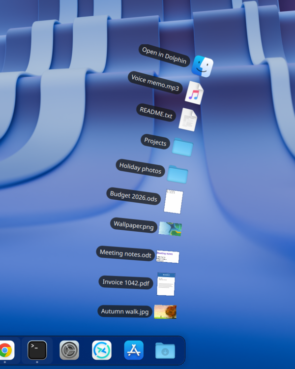
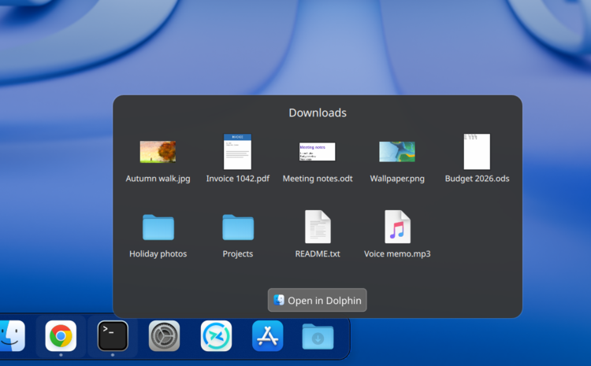
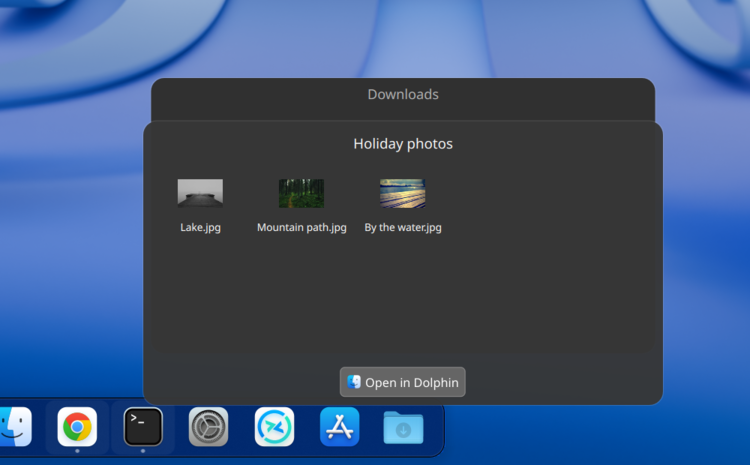
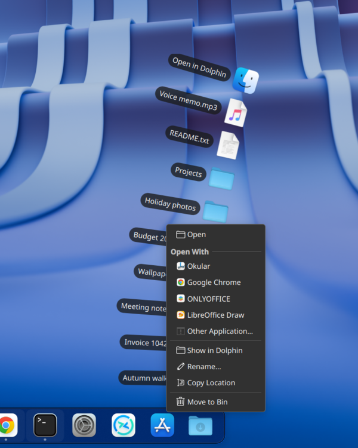
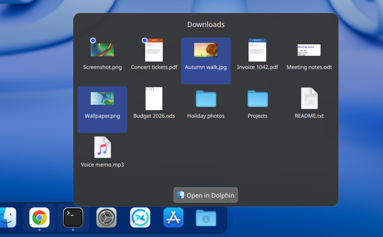
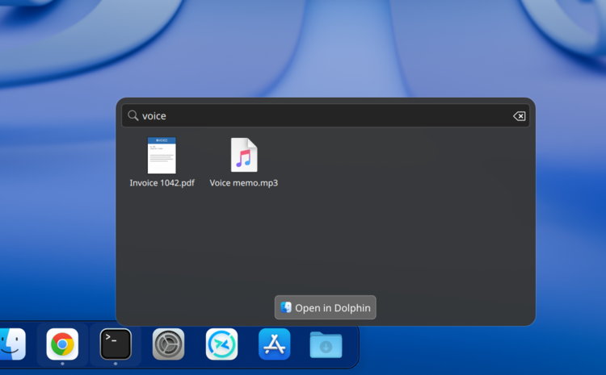
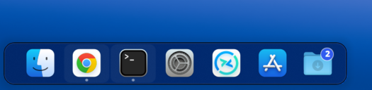

# Folder Stack — a macOS-style folder stack for the KDE Plasma 6 dock

Folder Stack is a Plasma 6 panel widget that works like a *Stack* in the macOS Dock. Click the folder icon and the folder's newest files fan up out of the dock in a curve, or open in a grid. Click a file to open it, or drag it somewhere else.

You can also right-click files (Open With, Rename, Move to Bin, …), select several at once, type to filter, see which files are new, and drop files onto the icon, or hold them there to drop them into a folder inside.

**Get it:** [KDE Store](https://store.kde.org/p/2379769/) · [Releases](https://github.com/XxKrustyxX/plasma-stack/releases) · or see [Install](#install).

It shows your **Downloads** folder by default. You can point it at any folder, or show your **recently used files** from every folder instead, and you can add several Stacks, each with its own settings.

<p align="center">
  
  
</p>

> **Status:** personal project. I use it every day, but it has only been tested on one setup (see [Tested on](#tested-on)). Bug reports from other distros and Plasma versions are very welcome.

---

## Features

**Opening the stack**
- **Fan:** the newest files arc upward from the dock icon, with a "N more in *File Manager*" row at the top when the folder has more.
- **Grid:** a rounded box showing every file in the folder. It has 3–5 columns, scrolls after 4 rows, and has an **Open in *File Manager*** button.
- **Automatic:** a fan when the files fit, a grid when there are more.
- Sort by **newest first** or **name**, and choose how many files the fan shows (3–20).
- **Fan labels** follow the curve, or stay **straight** for the sharpest text (the rows are still placed along the curve).

**Recent files**
- Instead of a folder, a Stack can show the **files you've opened or saved lately, from any folder**, newest first. Pick **Show: Recently used files** in the settings.
- It's the same list as KDE's Recent Files (`recentlyused:/files` in Dolphin, Recent Files in the app launcher), plus the list GNOME and GTK apps keep. Files that have since been deleted are left out, and so are folders.
- Previews, the right-click menu, selecting, dragging out and type to filter all work as usual. **Open in Dolphin** opens Dolphin's Recent Files view.
- Files can't be dropped onto it (there's no folder for them to go into), and there are no new-file dots or download alerts.

**Folders inside the stack**
- **In place (grid):** the folder opens inside the same box. A back button shows the parent folder's name, and <kbd>Backspace</kbd> goes back.
- **Stacked on top (grid and fan):** the folder opens as a new box or fan on top. The folders you came through stay visible behind it (as name strips above the grid, or as dimmed fans off to the right). Click one to jump back to that folder.


- **Open in *File Manager*** opens the folder you're currently in. <kbd>Esc</kbd> closes the stack (see [Keyboard and mouse](#keyboard-and-mouse) for what it cancels first).

**Works on any panel edge**
- On a dock along the **bottom**, the fan curves up out of it. On a dock along the **top**, it hangs down instead.
- On a dock down the **left or right** side, the stack always opens as the grid, like macOS. The settings page shows this instead of offering the fan, and your choice comes back if the dock moves to the top or bottom again.
- The grid, the stacked folders and the bounce all follow the dock's edge too.

**Right-click a file or folder**


- **Open**, plus **Open in *File Manager*** for folders.
- **Open With:** the apps that can open that file, your default first, plus **Other Application…** (KDE's "Choose Application" window).
- **Show in *File Manager***, with the file selected.
- **Rename** right in the stack. The name is selected without its ending, so `.pdf` stays. <kbd>Enter</kbd> or clicking elsewhere saves it, <kbd>Esc</kbd> cancels, and a name that's already taken is refused with a message.
- **Copy Location** and **Move to Bin**.

**Selecting several files**
- <kbd>Ctrl</kbd>-click adds or removes a file, <kbd>Shift</kbd>-click selects a range, and <kbd>Ctrl</kbd>+<kbd>A</kbd> selects everything shown. <kbd>Esc</kbd> clears the selection before it closes the stack.
- Dragging or right-clicking a selected file acts on the whole selection: Open All, Open With, Show, Copy Locations, Move to Bin. Rename and Other Application… only appear for a single file, and Open With is left out when the selection mixes files and folders.
- Right-clicking a file outside the selection drops the selection and acts on just that file. A plain click opens the file as usual and clears the selection.



**Type to filter**


- With the stack open, just start typing: a search box replaces the folder name and only files whose names contain the text are shown (capitals don't matter). <kbd>Enter</kbd> opens the first match, and <kbd>Esc</kbd>, the clear button or deleting the text brings everything back.
- The fan only shows a few files, so typing in the fan switches to the grid.
- The filter applies to the folder on show. Opening another folder, or closing the stack, clears it.

**New files**
- Files added since you last closed the stack get a dot, and the dock icon shows how many, like the badges on app icons. Closing the stack counts as "seen".
- Copies that keep an old date and files moved in from elsewhere count too. Downloads count once they've finished. Hidden files don't count.
- Only the Stack's own folder is watched, not the folders inside it. Changing the Stack's folder in the settings starts it fresh.
- The marks survive restarts and logging out. This can be turned off.



**Drag and drop**
- **Drag files out** of the fan or grid into a file manager, the desktop, an email, an upload box, and so on. The stack stays open while you drag.
- **Drop files onto the dock icon** to get a *Move Here / Copy Here / Cancel* menu, like Dolphin's. Hold <kbd>Shift</kbd> to move or <kbd>Ctrl</kbd> to copy without the menu. Links dropped from a browser are downloaded into the folder, and files that are already in the folder are skipped.
- **Drop into a subfolder** (macOS calls this spring-loading):
  - Hold the files over the dock icon for a moment (about ¾ of a second) and the stack opens.
  - Move over a folder inside it and it lights up. Hold there and it opens. This happens in the grid, and in the fan when *Folders open* is set to *Stacked on top*; otherwise you can still drop onto the folder.
  - Hold over one of the folders behind (a name strip above the grid, or an earlier fan) to go back up to it.
  - Drop on a folder to put the files there, or anywhere else in the box for the folder on show. The usual Move / Copy menu appears (<kbd>Shift</kbd> and <kbd>Ctrl</kbd> work too), then the stack closes.
  - Drag back out without dropping and the stack closes again.
- Drag a file from the stack onto one of its own folders to move it there.

**Previews**
- Pictures show the picture itself, PDFs their first page, videos a frame, music files their album art, and LibreOffice / Microsoft Office documents the preview stored inside them.
- Previews that Dolphin (or any other freedesktop-compliant app) has already made are reused from the shared `~/.cache/thumbnails` cache. Missing ones are made in the background and kept in `~/.cache/stack-widget/thumbnails`. Previews that haven't been used for 60 days are deleted.
- Previews can be turned off, so every file shows its plain icon.

**Downloads**
- Files that are still downloading in Firefox (`.part`), Chrome / Edge / Brave (`.crdownload`) or Opera (`.opdownload`) appear under their real name. They are faded, with a pulsing arrow and a live size ("Downloading… 6.3 MiB").
- A progress bar slides across the dock icon while anything is downloading. It can't show a percentage, because browsers don't record the final size anywhere a widget can read.
- The dock icon bounces when a download finishes. This can be turned off.

**Other**
- **Choose the dock icon** for each Stack with KDE's icon picker (any icon, or your own picture). By default it's picked from the folder: Downloads, Documents, Pictures and so on.
- Hovering over the dock icon shows the folder's name, in the same style as the dock's app icons.
- The "Open in …" buttons show the name of your default file manager (Dolphin, COSMIC Files, and so on) and open the folder in it.
- The popup is only built while the stack is open, so the widget is light when idle (a few MB in `plasmashell` and one inotify watch).

---

## Keyboard and mouse

| | |
|---|---|
| Click the dock icon | open / close the stack |
| Click a file | open it |
| Click a folder | open it in the stack (grid, or fan with *Stacked on top*), otherwise in the file manager |
| Right-click a file or folder | the file menu |
| <kbd>Ctrl</kbd>-click / <kbd>Shift</kbd>-click | add to the selection / select a range |
| <kbd>Ctrl</kbd>+<kbd>A</kbd> | select everything shown |
| Type letters | filter by name |
| <kbd>Enter</kbd> (while filtering) | open the first match |
| <kbd>Backspace</kbd> | go back to the parent folder (when not filtering or renaming) |
| <kbd>Esc</kbd> | cancels, in this order: renaming, the filter, the selection; otherwise closes the stack |
| Drag a file out | drag it (and the rest of the selection) into another app |
| Drop on the dock icon | Move / Copy menu; hold <kbd>Shift</kbd> to move, <kbd>Ctrl</kbd> to copy straight away |
| Hold a drag on the dock icon | opens the stack so you can drop into a folder inside |

---

## Tested on

| | |
|---|---|
| Distro | Fedora Linux 44 |
| Plasma | 6.7.5 |
| KDE Frameworks | 6.30 |
| Qt | 6.11.2 |
| Session | Wayland |
| Panel | dock along the **bottom** of the screen (Icons-only Task Manager, "Dodge windows" visibility) |
| Other edges | top, left and right checked with a test panel (fan, grid, stacked folders, settings page), not used day to day |

**That is the only setup it has been tested on.**

### Should work (untested)

- **Other distros running Plasma 6** (Arch, openSUSE, KDE neon, Kubuntu, Debian, and so on). Nothing in the widget is Fedora-specific, but package names differ. See [Dependencies](#dependencies), especially the note for Debian/Ubuntu.
- **Older Plasma 6 releases (6.0–6.6).** The widget only uses APIs that have existed since Plasma 6.0, and its metadata declares 6.0 as the minimum, but it has not been tried on anything older than 6.7.
- **X11 sessions.** Nothing in it is Wayland-specific.

**Not supported:** Plasma 5. The widget is written for the Plasma 6 / Qt 6 APIs and will not load on Plasma 5.

If you try it on something else, please [open an issue](https://github.com/XxKrustyxX/plasma-stack/issues) and say whether it worked, even if it worked fine. I'll add the result to this list.

---

## Dependencies

### Required

These come with a normal Plasma 6 desktop. **Debian/Ubuntu/Kubuntu** split QML modules into separate `qml6-module-…` packages, so the first two (and possibly the other QML modules) may need installing there.

| What | Why | Fedora | Arch | openSUSE | Debian / Ubuntu |
|---|---|---|---|---|---|
| Qt folder list QML module | lists the folder | `qt6-qtdeclarative` | `qt6-declarative` | `qt6-declarative-imports` | **`qml6-module-qt-labs-folderlistmodel`** |
| Qt Quick Dialogs QML module | folder picker in the settings | `qt6-qtdeclarative` | `qt6-declarative` | `qt6-declarative-imports` | **`qml6-module-qtquick-dialogs`** |
| Plasma 5 Support | runs the helper scripts | `plasma5support` | `plasma5support` | `plasma5support6` | `qml6-module-org-kde-plasma-plasma5support` |
| KDE Declarative | drag and drop | `kf6-kdeclarative` | `kdeclarative` | `kf6-kdeclarative` | `qml6-module-org-kde-draganddrop` |
| KDE Icon Themes QML module | icon picker in the settings | `kf6-kiconthemes` | `kiconthemes` | `kf6-kiconthemes` | `qml6-module-org-kde-iconthemes` |
| `kioclient`, `kstart` | move/copy/bin files, Open With | `kde-cli-tools` | `kde-cli-tools` | `kde-cli-tools6` | `kde-cli-tools` |
| `xdg-mime` | finds your default file manager and file types | `xdg-utils` | `xdg-utils` | `xdg-utils` | `xdg-utils` |
| `dbus-send` | Show in file manager, Copy Location | `dbus-tools` | `dbus` | `dbus-1-tools` | `dbus-bin` |
| `bash`, coreutils, findutils | helper scripts | always installed | | | |

### Optional

If one of these is missing, nothing breaks: that file type just keeps its normal icon. Pictures, and any preview Dolphin has already made, work without any of them. Without `python3` the right-click menu also has no app list under **Open With** (Other Application… still works), and a Stack set to **Recently used files** stays empty.

| What | Used for | Fedora | Arch | openSUSE | Debian / Ubuntu |
|---|---|---|---|---|---|
| `python3` | previews of everything except pictures; the app list under **Open With**; **Recently used files** | `python3` | `python` | `python3` | `python3` |
| `pdftoppm` | PDF pages | `poppler-utils` | `poppler` | `poppler-tools` | `poppler-utils` |
| `ffmpeg` | video frames, album art | `ffmpeg-free` (or `ffmpeg` from RPM Fusion) | `ffmpeg` | `ffmpeg` | `ffmpeg` |
| `gsf-office-thumbnailer` | LibreOffice / MS Office documents | `libgsf` | `libgsf` | `gsf-office-thumbnailer` | `libgsf-bin` |

> The Fedora package names were checked on Fedora 44. The names for other distros come from their package repositories as best I know them, but they haven't been checked on those systems. Corrections are welcome.

`install.sh` checks for the commands and QML modules above and warns about anything missing.

---

## Install

### From the KDE Store (easiest)

Right-click your panel → **Add or Manage Widgets…** → **Get New** → **Download New Plasma Widgets…**, search for **Folder Stack** and click **Install**. Then find **Folder Stack** in the widget list and drag it onto your dock.

Store page: https://store.kde.org/p/2379769/

Installing from the store doesn't check the dependencies for you. If the widget shows an error instead of a folder, see [Dependencies](#dependencies), especially on Debian/Ubuntu.

### With the script

```bash
git clone https://github.com/XxKrustyxX/plasma-stack.git
cd plasma-stack
bash install.sh
```

The script:
1. checks dependencies and warns about anything missing,
2. installs the widget (or updates it if it's already installed) into `~/.local/share/plasma/plasmoids/`,
3. adds it to the panel that has your task manager, after a spacer (skip this with `bash install.sh --no-dock`),
4. restarts Plasma so the new version loads. Plasma caches widget code, so updates won't show without a restart.

It looks for `qdbus6`, `qdbus-qt6` or `qdbus` (the name varies by distro) to add the widget to the panel. If none is found, add it yourself (see below). On systems without systemd user services, it falls back to `kquitapp6` / `kstart`, or asks you to log out and back in.

### From a release (no terminal)

1. Download `folder-stack-<version>.plasmoid` from the [Releases page](https://github.com/XxKrustyxX/plasma-stack/releases).
2. Right-click your panel → **Add or Manage Widgets…** → **Get New** → **Install Widget From Local File…** and choose the file.
3. Search for **Folder Stack** in the widget list and drag it onto your dock.

Like the store, this skips `install.sh`, so nothing checks the dependencies for you. If the widget shows an error instead of a folder, see [Dependencies](#dependencies), especially on Debian/Ubuntu.

### By hand

```bash
kpackagetool6 -t Plasma/Applet -i package     # first install
kpackagetool6 -t Plasma/Applet -u package     # updates
```

Then right-click your panel → **Add or Manage Widgets…** → search for **Folder Stack** → drag it onto the panel. After an update, log out and back in, or run `systemctl --user restart plasma-plasmashell`.

### Update

```bash
cd plasma-stack
git pull
bash install.sh
```

Your settings are kept.

### Uninstall

```bash
bash uninstall.sh                 # also deletes ~/.cache/stack-widget
bash uninstall.sh --keep-cache
```

This removes the widget from every panel and uninstalls it. The spacer that `install.sh` added next to it stays on the panel; remove it by hand if you don't want it.

---

## Settings

Right-click the Stack on the dock → **Configure Folder Stack…**

| Setting | Options | Default |
|---|---|---|
| Show | A folder / Recently used files | A folder |
| Folder | any folder (greyed out for Recently used files) | Downloads |
| Icon | Automatic, or any icon / picture | Automatic (from the folder) |
| Open as | Fan / Grid / Automatic (on a dock down the side: always Grid) | Fan |
| Folders open | In place (grid) / in file manager (fan), *or* Stacked on top | In place |
| Sort by | Newest first / Name | Newest first |
| Fan labels | Follow the curve / Straight (not shown for Grid or on a side dock) | Follow the curve |
| Items in the fan | 3–20 (not shown on a side dock) | 10 |
| Previews | Show previews of files | on |
| New files | Mark files added since you last looked | on |
| Downloads | Bounce when a download finishes | on |

Each Stack on the panel has its own settings, so you can have one for Downloads, one for Documents, and so on.

---

## Project layout

```
package/                         the widget (installed as a Plasma applet package)
├── metadata.json                id io.github.xxkrustyxx.stack, version, minimum Plasma API
└── contents/
    ├── config/main.xml          settings and their defaults
    ├── config/config.qml        settings page list
    ├── ui/main.qml              the dock icon, fan, grid, right-click menu, selection, filter,
    │                            renaming, drag and drop (incl. spring-loading), downloads, previews, new files
    ├── ui/configGeneral.qml     settings page
    └── code/
        ├── apps.py              lists the apps that can open a file (for Open With)
        ├── drop.sh              moves/copies files dropped on the stack (via kioclient)
        ├── file-actions.sh      the right-click menu's actions (open with, show, rename, bin, copy)
        ├── file-manager-name.sh prints the default file manager's name and desktop file
        ├── new-files.sh         lists files added since the stack was last closed
        ├── recent-files.py      lists recently used files (KDE's activity database + recently-used.xbel)
        └── thumbs.py            finds existing previews / makes missing ones
install.sh                       install / update / add to dock
uninstall.sh                     remove
build.sh                         makes dist/folder-stack-<version>.plasmoid for releases and the KDE Store
docs/screenshots/                the pictures in this README (made with a demo folder)
docs/kde-store.md                text for the KDE Store page
docs/logo.png                    the KDE Store logo (KDE's Breeze download-folder icon)
```

---

## Known limitations

- **No fan on a side dock.** On a dock down the left or right of the screen the stack always opens as the grid, as on macOS.
- **The panel gap fix relies on Plasma internals.** When you drag files over a Plasma panel, the panel opens a space for a new widget. Stack closes that space when you drop onto it by reaching into the panel's own drop area. If a future Plasma release changes that code, the space may stay open after a drop (it goes away when you move the mouse off the panel). Nothing else is affected.
- **Download progress has no percentage**, because browsers don't record the final file size anywhere a widget can read.
- **Microsoft Office files** only get a preview if the file has one saved inside it, which many don't.
- **Dropping into subfolders** relies on the stack, opened in the middle of a drag, receiving that drag from the other app. It works with real drags from Dolphin on the tested setup (Plasma 6.7, Wayland); other apps and compositors haven't been tried.
- **Copy Location** uses Plasma's clipboard service (Klipper), because a panel widget can't always set the clipboard itself on Wayland. Without Klipper it falls back to `wl-copy` or `xclip` if installed.
- **"New" uses the time a file arrived in the folder** (its inode change time), which is what catches copies and moves. The catch: renaming a file or changing its permissions outside the stack also marks it as new.
- **Open With on several files** starts the app once per file, so some apps open a window for each.
- **Other Application…** opens KDE's own "Choose Application" window, so it needs KDE's KIO (part of any Plasma desktop).
- **Recently used files** only knows about files an app reported opening or saving. KDE apps, the file dialog and GTK apps do; some others don't. It's empty if *System Settings → Recent Files* is set not to remember files. **Open in *File Manager*** is only shown for file managers that can show KDE's Recent Files (Dolphin, Konqueror, Krusader).
- **Recently used files** skips files on a network drive that doesn't answer within half a second, so an offline share can't hold the list up.

## Building a release

```bash
bash build.sh        # → dist/folder-stack-<version>.plasmoid
```

The version comes from `package/metadata.json`.

## Ideas / roadmap

- "Display as Stack": the dock icon shows a pile of the newest files' icons
- List view, with subfolders that open when you hover over them
- Quick options when you right-click the dock icon (sort, view)
- More sort options (date added, date created, kind, size)
- Arrow-key navigation in the grid, and Quick Look with <kbd>Space</kbd>
- Tidy-up: fade old downloads, with a button to move them to the Bin
- Filters: hide hidden files, or show only some types (for example, pictures only)
- Recently **added** files: the newest files from several folders you pick, whether or not you've opened them

Suggestions and pull requests are welcome.

---

## License

GPL-2.0-or-later. See [LICENSE](LICENSE).
